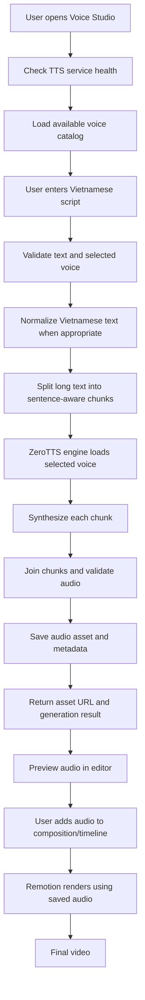

# PRD — REMOTION-LC ZeroTTS Voice Studio

- **Product:** REMOTION-LC
- **Feature:** ZeroTTS Voice Studio
- **Document type:** Product Requirements Document
- **Status:** Implementation specification
- **Version:** 1.0
- **Date:** 2026-11-07

---

## 1. Executive summary

REMOTION-LC cần tích hợp một khu vực **Voice Studio** trực tiếp vào giao diện biên tập video hiện tại. Người dùng có thể nhập lời thoại, chọn một trong 8 giọng tiếng Việt có sẵn của ZeroTTS, nghe thử, tạo file âm thanh và đưa kết quả vào quy trình dựng video Remotion.

Tính năng phải được tích hợp vào kiến trúc hiện tại sau khi AI agent khảo sát mã nguồn. Không được tạo một ứng dụng độc lập thay thế REMOTION-LC, không được phá vỡ các chức năng editor đang có và không được giả định cấu trúc source code trước khi kiểm tra repository.

### 1.1 Product vision

Biến REMOTION-LC thành một công cụ tạo video có quy trình voice-over liền mạch:

**Viết lời thoại → Chọn giọng → Preview → Generate → Quản lý audio → Đưa vào timeline → Render video.**

### 1.2 Mục tiêu

1. Tích hợp ZeroTTS vào REMOTION-LC thông qua service có ranh giới rõ ràng.
2. Hiển thị và sử dụng đủ 8 voice preset chính thức.
3. Cho phép người dùng chọn giọng ngay trên UI editor hiện tại.
4. Cho phép nhập văn bản, tạo audio, nghe thử và tạo lại khi cần.
5. Quản lý audio đã tạo và đưa audio vào composition/timeline theo kiến trúc hiện có.
6. Giữ cho quá trình render Remotion có thể tái lập, không phụ thuộc vào việc TTS đang chạy tại thời điểm render.

### 1.3 Không thuộc phạm vi MVP

- Không tự huấn luyện hoặc fine-tune mô hình TTS.
- Không tự xây dựng voice encoder.
- Không tuyên bố có thể clone giọng trực tiếp từ file ghi âm bằng package ZeroTTS local.
- Không triển khai hệ thống tài khoản, thanh toán hoặc cloud voice marketplace.
- Không thay thế toàn bộ editor hoặc viết lại Remotion Studio.
- Không tự động dịch hoặc viết lại nội dung người dùng.

---

## 2. Product context và nguyên tắc tích hợp

Repository hiện có tên `REMOTION-LC`, dùng TypeScript/Remotion theo cấu trúc quan sát ban đầu gồm `src/`, `public/`, `package.json`, `remotion.config.ts` và các file cấu hình khác. Đây chỉ là thông tin ban đầu từ Explorer; agent bắt buộc phải kiểm tra mã nguồn thực tế trước khi thay đổi.

Ảnh giao diện hiện tại cho thấy workspace có:
- Khu vực Compositions và Assets bên trái.
- Canvas preview ở giữa.
- Panel Composition/Actions bên phải.
- Timeline và các điều khiển playback phía dưới.

### Nguyên tắc UI

- Tích hợp tính năng chọn giọng vào workspace hiện tại, ưu tiên panel bên phải hoặc một tab/panel Voice Studio phù hợp với kiến trúc UI hiện có.
- Giữ nguyên các khu vực Composition, Assets, Preview và Timeline.
- Không sửa trực tiếp source của package `node_modules` hoặc fork/chỉnh sửa nội bộ Remotion Studio nếu không có bằng chứng kiến trúc yêu cầu.
- Nếu giao diện hiện tại là custom editor riêng, thêm component vào đúng layout và design system của ứng dụng.
- Nếu giao diện là Remotion Studio upstream và không hỗ trợ extension point cần thiết, phải báo cáo giới hạn và đề xuất tích hợp qua ứng dụng wrapper/custom editor; không giả vờ rằng có thể chèn panel tùy ý vào upstream Studio.

---

## 3. Người dùng mục tiêu và use cases

### 3.1 Người dùng mục tiêu

Người làm video ngắn, video giải thích, video kể chuyện, nội dung giáo dục hoặc video tin tức bằng tiếng Việt.

### 3.2 Use cases

1. Người dùng viết hoặc dán một đoạn kịch bản.
2. Người dùng chọn một trong tám giọng ZeroTTS.
3. Người dùng nghe thử giọng hoặc nghe audio vừa tạo.
4. Người dùng tạo audio từ toàn bộ văn bản hoặc từng đoạn.
5. Người dùng đổi voice và tạo lại audio.
6. Người dùng quản lý các audio đã sinh.
7. Người dùng thêm audio vào composition/timeline hiện tại.
8. Người dùng render video và kiểm tra audio đầu ra.

---

## 4. Danh sách 8 voice preset bắt buộc

Tất cả 8 voice phải được hiển thị nếu model/runtime trả về đầy đủ. Không hard-code giả lập trạng thái sẵn sàng nếu model chưa tải hoặc voice không có trong runtime.

| ID | Tên hiển thị | Giới tính | Đặc điểm / tags gợi ý |
|---|---|---|---|
| `maichi` | Mai Chi | Nữ | Trẻ, kể chuyện, nhẹ nhàng, thân thiện |
| `baotrang` | Bảo Trang | Nữ | Trưởng thành, tin tức, rõ ràng, trung tính |
| `kimoanh` | Kim Oanh | Nữ | Trung niên, kể chuyện, ấm áp, truyền cảm |
| `hamy` | Hà My | Nữ | Trẻ, hoạt hình, cao, biểu cảm |
| `giahuy` | Gia Huy | Nam | Trẻ, kể chuyện, trầm ấm, tâm tình |
| `huuduc` | Hữu Đức | Nam | Lớn tuổi, kể chuyện, trầm, điềm đạm |
| `quangminh` | Quang Minh | Nam | Trẻ, tin tức, rõ ràng, dứt khoát |
| `tiendat` | Tiến Đạt | Nam | Trẻ, bình luận, sôi nổi, năng lượng cao |

### Yêu cầu voice catalog

- Dùng `tts.list_voices()` và/hoặc `tts.load_voice()` theo API thực tế của phiên bản ZeroTTS đã cài để xác minh voice runtime.
- Lấy metadata thực tế từ voice pack nếu thư viện cung cấp.
- Có fallback metadata hiển thị từ catalog tĩnh để UI vẫn trình bày được tên và tags khi backend đang khởi động; trạng thái khả dụng phải phản ánh đúng runtime.
- Không tự tạo preview audio giả. Nếu upstream có preview clip hợp lệ thì dùng đúng asset và tuân thủ license.
- Người dùng phải nghe được voice thông qua preview TTS ngắn hoặc audio preview có sẵn.
- Lưu voice ID cùng audio metadata để biết audio được tạo bằng giọng nào.

**Giới hạn quan trọng:** ZeroTTS package hiện công bố tám preset được đóng gói cùng model. Khả năng cài voice pack bổ sung không đồng nghĩa package local tự clone giọng từ file ghi âm. Tài liệu upstream nêu voice encoder không được phát hành trong package; không xây dựng UI hứa hẹn local voice cloning nếu chưa có dịch vụ/latent hợp lệ.

---

## 5. Phạm vi chức năng

### 5.1 Voice Studio UI

Một khu vực mới trong editor, tên hiển thị **Voice Studio** hoặc **AI Voice**.

Thành phần giao diện:

1. **Text input**
   - Textarea nhập hoặc dán kịch bản.
   - Hiển thị số ký tự/từ.
   - Có trạng thái trống và validation.
   - Hỗ trợ văn bản tiếng Việt có dấu.

2. **Voice selector**
   - Hiển thị đủ 8 voice preset.
   - Có tên, giới tính, mô tả ngắn và tags.
   - Có thể lọc Nữ/Nam và tìm theo tên.
   - Voice đang chọn phải được highlight rõ ràng.
   - Không tự đổi voice khi người dùng chuyển tab/panel.

3. **Preview**
   - Nút nghe thử voice.
   - Nếu preview được sinh theo văn bản mẫu, dùng một câu mẫu tiếng Việt ngắn và nhất quán để so sánh.
   - Có loading, playing, stop và error state.
   - Không tạo nhiều request trùng lặp khi người dùng nhấn liên tục.

4. **Generation settings**
   - MVP dùng thông số ZeroTTS mặc định đã được upstream khuyến nghị.
   - Có thể thiết kế vùng Advanced Settings nhưng không expose tham số chưa được xác minh.
   - Không tự ý thay đổi `cfg_scale`, temperature, top-k/top-p hoặc repetition penalty khỏi default khi chưa có kiểm thử chất lượng.

5. **Generate**
   - Nút Generate Audio.
   - Hiển thị tiến trình và trạng thái.
   - Chặn submit rỗng.
   - Có thể hủy request nếu backend hỗ trợ an toàn.
   - Hiển thị lỗi có thể hiểu được, không làm lộ stack trace cho người dùng.

6. **Audio result**
   - Audio player.
   - Tên file, voice ID, thời gian tạo, thời lượng nếu đọc được.
   - Nút Add to Timeline / Use in Composition.
   - Nút tạo lại và xóa theo quy tắc quản lý asset hiện tại.

7. **Generated audio library**
   - Liệt kê các audio đã tạo.
   - Có thể tìm kiếm/lọc theo voice.
   - Cho phép nghe lại.
   - Không xóa file đang được composition tham chiếu nếu chưa có xác nhận hoặc cơ chế kiểm tra dependency.

### 5.2 TTS API

Backend phải cung cấp API nội bộ cho frontend. Ưu tiên FastAPI/Python cho ZeroTTS engine, nhưng agent cần kiểm tra repository xem đã có backend/service nào hay chưa. Không tạo backend thứ hai nếu đã có service phù hợp.

API đề xuất:

| Method | Endpoint | Mục đích |
|---|---|---|
| `GET` | `/api/tts/health` | Kiểm tra trạng thái service/model |
| `GET` | `/api/tts/voices` | Trả danh sách voice khả dụng |
| `POST` | `/api/tts/preview` | Tạo preview ngắn cho voice |
| `POST` | `/api/tts/generate` | Sinh audio từ văn bản |
| `GET` | `/api/tts/jobs/{job_id}` | Lấy trạng thái job nếu dùng async job |
| `GET` | `/api/tts/assets` | Danh sách audio đã tạo |
| `DELETE` | `/api/tts/assets/{asset_id}` | Xóa asset nếu không bị composition sử dụng |

Các endpoint là hợp đồng đề xuất, không bắt buộc phải giữ nguyên nếu dự án đã có quy ước API khác. Agent phải ghi rõ endpoint thực tế trong tài liệu sau triển khai.

#### Request generate tham khảo

```json
{
  "text": "Xin chào mọi người, chào mừng đến với video hôm nay.",
  "voice_id": "maichi"
}
```

#### Response generate tham khảo

```json
{
  "asset_id": "generated-audio-id",
  "voice_id": "maichi",
  "file_name": "generated-audio-id.wav",
  "audio_url": "/audio/generated/generated-audio-id.wav",
  "format": "wav",
  "sample_rate": 48000,
  "status": "completed"
}
```

Đây là schema minh họa. Sample rate, format và URL phải lấy từ audio thực tế, không được hard-code nếu khác output runtime.

### 5.3 Audio asset management

- File sinh ra phải được lưu trong vùng asset do ứng dụng quản lý.
- Nếu lưu trong `public/`, dùng đường dẫn tương thích với Remotion `staticFile()` khi render.
- Nếu ứng dụng đã có asset manager/storage abstraction, tái sử dụng thay vì tạo hệ thống lưu file song song.
- Tên file phải tránh trùng lặp; không dùng trực tiếp nội dung văn bản làm tên file.
- Lưu metadata tối thiểu: asset ID, filename/path, voice ID, text hoặc tham chiếu đến text, createdAt, duration, sampleRate, status.
- Kiểm tra đường dẫn file để ngăn path traversal.
- Chỉ cho phép frontend truy cập asset qua cơ chế an toàn của ứng dụng.

### 5.4 Remotion integration

- Audio đã sinh phải có thể preview trong editor.
- Có hành động đưa audio vào composition/timeline.
- Khi render, Remotion phải đọc file audio đã tạo, không gọi ZeroTTS trong render process.
- Tái sử dụng audio asset đã sinh khi render lại, tránh tạo lại TTS ngoài ý muốn.
- Đồng bộ đúng thời điểm bắt đầu, thời lượng và track/layer theo timeline model hiện tại.
- Nếu timeline hiện tại chưa có mô hình audio track, agent phải đề xuất cách tích hợp tối thiểu phù hợp với kiến trúc hiện có trước khi tạo một timeline system mới.
- Không tự ý thay đổi fps, resolution hoặc duration của composition khi thêm audio.
- Cần xử lý trường hợp audio dài hơn composition: cảnh báo hoặc đề xuất cập nhật duration, không tự cắt âm thanh âm thầm.

---

## 6. Pipeline end-to-end

### 6.1 Pipeline tổng thể



### 6.2 Pipeline chi tiết

**Stage 1 — Service initialization**
- Khởi tạo TTS service khi cần hoặc lúc backend startup theo chiến lược phù hợp.
- Load model một lần và tái sử dụng instance; không load lại model cho từng request.
- Kiểm tra cache model và khả năng tải weights lần đầu.
- Trả trạng thái `starting`, `ready` hoặc `error`.
- Nếu model chưa sẵn sàng, UI phải hiển thị trạng thái rõ ràng.

**Stage 2 — Voice discovery**
- Lấy voice catalog từ runtime.
- Đối chiếu với danh sách tám preset mong muốn.
- Chỉ đánh dấu voice khả dụng khi runtime xác nhận.
- UI không được cho Generate bằng voice ID không hợp lệ.

**Stage 3 — Input validation**
- Loại bỏ input rỗng hoặc chỉ chứa khoảng trắng.
- Giới hạn kích thước request theo cấu hình.
- Xác thực `voice_id` thuộc danh sách runtime.
- Báo lỗi dễ hiểu nếu văn bản vượt giới hạn.
- Không âm thầm cắt nội dung.

**Stage 4 — Text preprocessing**
- Chuẩn hóa dấu câu và khoảng trắng.
- Dùng `normalize_vi_text()` cho văn bản tiếng Việt khi phù hợp.
- Không áp dụng quy tắc chuẩn hóa tiếng Việt cho nội dung tiếng Anh thuần.
- Không thay đổi ý nghĩa, tên riêng hoặc từ viết tắt ngoài các quy tắc chuẩn hóa đã xác minh.
- Cho phép tắt normalization nếu cần giữ nguyên văn bản.

**Stage 5 — Long-text chunking**
- Dùng cơ chế chunking tương thích ZeroTTS, ưu tiên `zerotts.chunking` nếu có trong phiên bản cài đặt.
- Chia theo câu/dấu câu, không cắt tùy tiện giữa từ.
- Đặt giới hạn chunk theo cấu hình có thể kiểm thử.
- Giữ thứ tự chunk.
- Giữ cùng voice ID cho mọi chunk của một tác vụ để speaker identity nhất quán.
- Nếu một chunk lỗi, ghi nhận chunk lỗi và không báo thành công toàn bộ.

**Stage 6 — Synthesis**
- Dùng `ZeroTTS.synthesize(text, voice=voice_id)` hoặc API tương ứng của phiên bản đang cài.
- Dùng `synthesize_stream()` chỉ khi sản phẩm cần streaming preview; không bắt buộc cho MVP.
- Tái sử dụng engine/model instance.
- Hạn chế số tác vụ inference chạy đồng thời theo CPU/RAM thực tế.
- Không giả định GPU là bắt buộc.

**Stage 7 — Audio post-processing**
- Nối các chunk theo đúng thứ tự.
- Kiểm tra audio không rỗng, duration hợp lệ và sample rate.
- Tránh thêm silence hoặc normalize âm lượng ngoài ý muốn.
- Nếu cần chuyển đổi định dạng/sample rate, thực hiện bằng công cụ đã có trong project hoặc dependency được phê duyệt.
- Không làm giảm chất lượng audio âm thầm.

**Stage 8 — Persistence**
- Lưu audio vào thư mục asset do project quản lý.
- Ghi metadata và trạng thái hoàn tất.
- Dùng asset ID duy nhất.
- Nếu lưu thất bại, không trả trạng thái completed.
- Dọn file tạm khi job lỗi hoặc bị hủy.

**Stage 9 — Preview**
- Trả URL asset cho frontend.
- Dùng audio player để nghe thử.
- Hiển thị voice được sử dụng và thông tin tác vụ.
- Có thể tạo lại bằng voice khác mà không ghi đè asset cũ.

**Stage 10 — Timeline and render**
- Người dùng chọn Add to Timeline.
- Tạo audio layer/track theo data model hiện tại.
- Composition tham chiếu asset đã lưu.
- Render chỉ đọc audio asset; không gọi TTS engine.
- Xác minh audio xuất hiện trong video render cuối.

---

## 7. Kiến trúc kỹ thuật đề xuất

### 7.1 Phân chia trách nhiệm

| Layer | Trách nhiệm |
|---|---|
| Existing Remotion UI | Workspace, panel, composition và timeline |
| Voice Studio components | Text input, voice picker, preview, generation state |
| TTS API client | Gọi API, xử lý response và lỗi |
| TTS backend | Validation, job orchestration, asset management |
| ZeroTTS adapter | Đóng gói API thư viện ZeroTTS |
| Audio storage | Lưu file và metadata |
| Remotion composition | Phát audio asset khi preview/render |

### 7.2 Cấu trúc thư mục tham khảo

Đây là cấu trúc gợi ý, không phải yêu cầu phải tạo đúng từng thư mục. Agent phải tuân thủ cấu trúc hiện hữu.

```text
REMOTION-LC/
├── public/
│   └── audio/
│       └── generated/
├── src/
│   ├── components/
│   │   └── voice-studio/
│   │       ├── VoiceStudioPanel.tsx
│   │       ├── VoiceSelector.tsx
│   │       ├── VoiceCard.tsx
│   │       ├── ScriptEditor.tsx
│   │       ├── AudioPreview.tsx
│   │       └── GeneratedAudioList.tsx
│   ├── services/
│   │   └── tts-api.ts
│   ├── hooks/
│   │   └── useTTS.ts
│   └── types/
│       └── tts.ts
├── tts-service/
│   ├── app/
│   │   ├── main.py
│   │   ├── api/
│   │   ├── services/
│   │   │   └── zerotts_engine.py
│   │   ├── schemas/
│   │   └── storage/
│   ├── requirements.txt
│   └── README.md
└── PRD.md
```

### 7.3 Backend dependency

Ưu tiên package chính thức:

```bash
pip install zerotts
```

Không cài PyTorch chỉ để chạy inference nếu package hiện tại không yêu cầu. Upstream mô tả runtime inference dùng ONNX Runtime; optional `eval` mới cần PyTorch.

Agent phải:
- Kiểm tra Python version tương thích theo package release hiện tại.
- Tạo virtual environment riêng cho TTS service nếu project chưa có Python backend.
- Pin dependency version sau khi test thành công.
- Không cài package vào global Python environment.
- Không commit model weights/cache lớn vào Git.
- Ghi hướng dẫn cài đặt và chạy local.

### 7.4 ZeroTTS adapter

Tạo lớp adapter duy nhất để frontend/backend route không phụ thuộc trực tiếp vào chi tiết thư viện.

Adapter chịu trách nhiệm:
- Load model một lần.
- Lấy danh sách voices.
- Kiểm tra voice ID.
- Generate audio.
- Chunking và normalization.
- Trả metadata audio.
- Chuyển exception thành lỗi có cấu trúc.

Ví dụ API upstream cần xác minh với package đã cài:

```python
from zerotts import ZeroTTS

tts = ZeroTTS.from_pretrained("zeroweight-ai/ZeroTTS")

voices = tts.list_voices()

audio = tts.synthesize(
    "Xin chào mọi người.",
    voice="maichi",
)

tts.save_audio(audio, "output.wav")
```

Không sao chép mù quáng ví dụ này nếu signature thực tế của version đã pin khác.

---

## 8. UI/UX requirements

### 8.1 Bố cục đề xuất

Voice Studio có thể được đặt trong panel bên phải hoặc tab riêng trong workspace hiện tại:

```text
┌───────────────────────────────────────┐
│ Voice Studio                          │
├───────────────────────────────────────┤
│ Script                                │
│ [ Nhập nội dung cần đọc...          ] │
│                                       │
│ Voice                                 │
│ [Mai Chi] [Bảo Trang] [Kim Oanh]     │
│ [Hà My]   [Gia Huy]   [Hữu Đức]      │
│ [Quang Minh]        [Tiến Đạt]        │
│                                       │
│ [Preview Voice]                       │
│                                       │
│ [Generate Audio]                      │
│                                       │
│ Generated Audio                       │
│ [▶ Play]  Mai Chi · output.wav        │
│ [Add to Timeline]                     │
└───────────────────────────────────────┘
```

Không bắt buộc dùng đúng layout này; cần theo design system và kích thước panel thực tế.

### 8.2 States

- `idle`: chưa có nội dung/tác vụ.
- `checking`: đang kiểm tra TTS service.
- `loading`: đang tải model hoặc voice catalog.
- `generating`: đang sinh audio.
- `completed`: audio đã được lưu.
- `playing`: đang nghe preview.
- `error`: có lỗi.
- `service_unavailable`: backend không kết nối được.

### 8.3 Accessibility và usability

- Nút có label rõ ràng.
- Trạng thái loading không làm mất nội dung đã nhập.
- Keyboard navigation hoạt động.
- Không chỉ dùng màu sắc để biểu thị voice đang chọn.
- UI phải hoạt động ở kích thước cửa sổ hiện tại và không che canvas/timeline.
- Có thông báo xác nhận trước khi xóa audio đang được sử dụng.

---

## 9. Non-functional requirements

### Performance
- Model chỉ được load một lần trong vòng đời service, trừ khi có lý do kỹ thuật.
- Không block UI thread trong khi generate.
- Có loading/progress state.
- Giới hạn concurrency để bảo vệ CPU/RAM.
- Đo thời gian cold start và thời gian generate bằng dữ liệu thực tế.

### Reliability
- Backend mất kết nối không làm crash editor.
- TTS job lỗi phải trả lỗi có cấu trúc.
- Audio file chỉ được đánh dấu completed sau khi lưu thành công và xác minh đọc được.
- Render không phụ thuộc service TTS đang hoạt động.

### Security
- Chỉ bind service local theo cấu hình phù hợp; không public endpoint mặc định.
- Validate input và file path.
- Không expose secret/API key ở frontend.
- Không cho phép tên file từ user điều khiển đường dẫn lưu tùy ý.
- Không upload script hoặc audio lên dịch vụ ngoài nếu người dùng chưa chủ động cấu hình.

### Maintainability
- Tách adapter ZeroTTS khỏi UI.
- TypeScript types cho API request/response.
- Có README cài đặt và troubleshooting.
- Có test cho API, adapter và UI state.
- Pin dependency và ghi rõ version đã xác minh.

---

## 10. Error handling

| Trường hợp | Hành vi |
|---|---|
| TTS service không chạy | Hiện hướng dẫn khởi động service, không crash UI |
| Model chưa tải | Hiện trạng thái tải model và lỗi nếu thất bại |
| Voice ID không tồn tại | Refresh voice catalog và yêu cầu chọn voice hợp lệ |
| Text rỗng | Disable Generate hoặc hiển thị validation |
| Text quá dài | Báo giới hạn và đề xuất chia đoạn |
| Một chunk synthesis lỗi | Báo job thất bại/partial theo khả năng thực tế; không báo complete giả |
| Không ghi được file | Báo lỗi storage, dọn file tạm |
| Audio không đọc được | Không cho Add to Timeline |
| Render không tìm thấy audio | Báo asset path lỗi và chỉ rõ asset liên quan |
| Người dùng đóng panel khi generate | Job không được tự mất dữ liệu; trạng thái phải truy xuất lại được nếu backend hỗ trợ |

---

## 11. Acceptance criteria

MVP chỉ được xem là hoàn thành khi đáp ứng tất cả tiêu chí quan trọng sau:

### AC-01 — Voice catalog
- [ ] UI hiển thị đủ 8 preset với đúng voice ID.
- [ ] Tên và metadata đúng với upstream.
- [ ] Voice unavailable được biểu thị chính xác.
- [ ] Không có voice giả hoặc preview giả.

### AC-02 — Voice selection
- [ ] Chọn được từng voice.
- [ ] Voice ID được gửi đúng đến backend.
- [ ] Đổi voice không làm mất nội dung script.

### AC-03 — Preview
- [ ] Có thể nghe preview của voice.
- [ ] Có loading/error state.
- [ ] Không phát chồng nhiều audio ngoài ý muốn.

### AC-04 — Generate
- [ ] Tạo được WAV/audio output thực tế bằng ZeroTTS.
- [ ] Có thể tạo bằng cả 8 voice.
- [ ] Text tiếng Việt có dấu được xử lý đúng.
- [ ] Văn bản dài được chunk theo câu và giữ đúng thứ tự.
- [ ] Không báo thành công khi file chưa lưu được.

### AC-05 — Asset management
- [ ] Audio được lưu ở vị trí ổn định.
- [ ] Metadata có voice ID và đường dẫn.
- [ ] Có thể nghe lại audio đã tạo.
- [ ] Không ghi đè nhầm asset cũ.

### AC-06 — Remotion
- [ ] Có thể thêm audio vào composition/timeline.
- [ ] Audio phát đúng trong preview.
- [ ] Render video có âm thanh đúng.
- [ ] Render lại không kích hoạt TTS generation lần nữa.
- [ ] Không phá vỡ composition và chức năng hiện có.

### AC-07 — Quality
- [ ] Typecheck/build hiện tại vẫn pass.
- [ ] Test mới pass.
- [ ] Không có lỗi nghiêm trọng trong console/log.
- [ ] Có README hướng dẫn setup và chạy cả frontend lẫn TTS service.

---

## 12. Testing plan

### Unit tests
- Voice catalog mapping.
- Voice ID validation.
- Text validation và normalization.
- Chunk ordering.
- Asset metadata.
- API error mapping.

### Integration tests
- Backend khởi tạo ZeroTTS.
- Lấy được danh sách tám voice.
- Generate audio với từng voice.
- Audio file được lưu và đọc lại.
- Frontend gọi API và hiển thị kết quả.

### Remotion tests
- Composition đọc được audio asset.
- Preview phát audio.
- Render output chứa audio.
- Render lại dùng asset cũ.

### Manual QA
- Thử cả 8 voice với cùng một câu tiếng Việt.
- Thử đoạn ngắn, đoạn nhiều câu, số/ngày tháng và từ có dấu.
- Thử backend tắt/mở lại.
- Thử generate liên tiếp và đổi voice.
- Thử thêm audio vào composition đang có nội dung.

Không dùng benchmark do upstream công bố để thay thế kiểm thử trên máy thực tế.

---

## 13. Implementation milestones

### Phase 0 — Repository audit
Deliverables:
- Xác định entry point frontend.
- Xác định Remotion version và cách chạy Studio/editor.
- Xác định timeline/asset data model.
- Kiểm tra backend hiện tại.
- Ghi lại baseline build/test.
- Đưa ra phương án tích hợp UI đúng với kiến trúc thực tế.

**Exit criteria:** Có báo cáo audit và kế hoạch file-level; chưa thay đổi kiến trúc lớn.

### Phase 1 — ZeroTTS proof of concept
Deliverables:
- Python environment.
- Cài package ZeroTTS.
- Load model.
- Xác minh 8 voice ID.
- Sinh và phát thử một WAV cho từng voice.
- Đo thời gian tải model và generate.

**Exit criteria:** 8/8 voice tạo được audio trên môi trường phát triển.

### Phase 2 — TTS backend
Deliverables:
- ZeroTTS adapter.
- Health/voices/preview/generate APIs.
- Validation, chunking, error handling.
- Audio storage và metadata.

**Exit criteria:** API integration test pass; audio được lưu ổn định.

### Phase 3 — Voice Studio UI
Deliverables:
- Voice selector.
- Script editor.
- Preview.
- Generate action và loading/error states.
- Generated audio list/player.

**Exit criteria:** Người dùng tạo và nghe audio từ UI, không cần chạy script thủ công.

### Phase 4 — Remotion integration
Deliverables:
- Add to timeline/composition.
- Audio asset reference.
- Preview playback.
- Render output có âm thanh.

**Exit criteria:** Render end-to-end thành công và không gọi TTS trong render.

### Phase 5 — Stabilization
Deliverables:
- Tests.
- README.
- Troubleshooting.
- Dependency pinning.
- Performance notes.
- Final implementation report.

**Exit criteria:** Build/test pass, không có regression đã biết, hướng dẫn chạy lại được.

---

## 14. Risks and mitigations

| Risk | Mitigation |
|---|---|
| Chưa rõ UI hiện tại là upstream Studio hay custom editor | Audit trước; chỉ tích hợp qua extension point hoặc custom wrapper hợp lệ |
| Python backend chưa tồn tại | Tạo service riêng chỉ khi audit xác nhận cần thiết |
| Model tải lần đầu khá lớn | Có loading state, cache model, hướng dẫn dung lượng và thời gian tải |
| CPU inference ảnh hưởng máy | Giới hạn concurrency, benchmark trên máy thật |
| Văn bản dài tạo nhiều chunk | Chunk theo câu, giữ cùng voice, ghép có kiểm tra |
| Voice pack không tương thích model | Dùng API cài đặt chính thức và validate theo runtime |
| Render không tìm thấy asset | Dùng asset path ổn định và kiểm tra trước render |
| Người dùng tưởng local package tự clone voice | Nêu rõ giới hạn; không quảng cáo tính năng chưa được hỗ trợ |

---

## 15. Definition of Done

Tính năng chỉ được coi là Done khi:
1. Có báo cáo repository audit.
2. Có ZeroTTS adapter/backend hoạt động.
3. UI tích hợp vào đúng workspace hiện tại.
4. Có đủ tám voice preset thực tế.
5. Có thể nhập script, preview, generate và nghe audio.
6. Có thể đưa audio vào composition/timeline.
7. Render video có audio chính xác.
8. Build/typecheck/test pass.
9. README mô tả setup, start, stop và troubleshooting.
10. Có báo cáo file thay đổi, lệnh kiểm thử và các giới hạn còn lại.

---

## 16. Official references

- ZeroTTS repository: https://github.com/zeroweight-ai/ZeroTTS
- Voice catalog: https://github.com/zeroweight-ai/ZeroTTS/blob/main/docs/VOICES.md
- ZeroTTS releases: https://github.com/zeroweight-ai/ZeroTTS/releases
- Remotion staticFile: https://www.remotion.dev/docs/staticfile
- Remotion Audio: https://www.remotion.dev/docs/media/audio

**Implementation note:** Tài liệu upstream có thể thay đổi. AI agent phải kiểm tra README, release notes, API signatures và version đang cài tại thời điểm triển khai; không dựa duy nhất vào ví dụ trong PRD.
