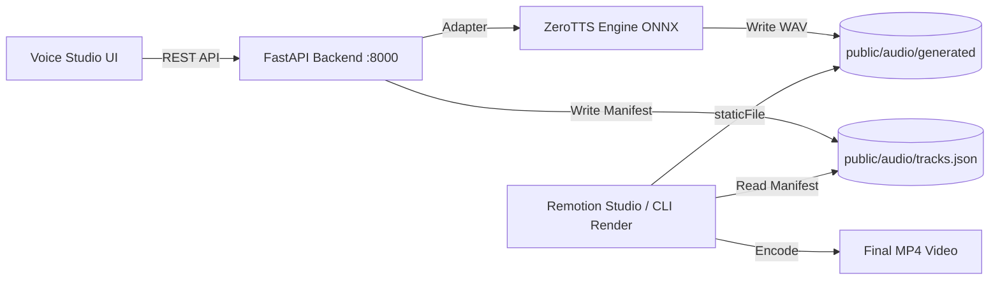

# REMOTION-LC — Current Architecture Analysis

## 1. Executive Overview

REMOTION-LC is a TypeScript & React-based video production and editing workspace powered by **Remotion** (v4.0.541) and integrated with **ZeroTTS** (Vietnamese Neural Text-To-Speech).

### Key Architectural Characteristics
- **Frontend / Rendering Framework:** Remotion 4.0.541 with React 19 and Bundler (Rspack/Webpack).
- **Video Canvas:** Standard 16:9 (`1280x720`) composition (`MyComp`) with real-time waveform animation, frame & timestamp visualizers, subtitle sequence mapping, and dynamic duration extension.
- **Backend TTS Engine:** Independent FastAPI microservice located in `tts-service/` running Python 3.12 with ONNX Runtime, exposing REST APIs at `http://127.0.0.1:8000/api/tts/`.
- **ZeroTTS Integration:** Model loaded once via a singleton adapter (`ZeroTTSEngine`), supporting all 8 official Vietnamese voice presets (`maichi`, `baotrang`, `kimoanh`, `hamy`, `giahuy`, `huuduc`, `quangminh`, `tiendat`), Vietnamese text normalization (`normalize_vi_text`), and sentence-aware chunking (`chunk_text`).
- **Asset Storage & Timeline Persistence:**
  - WAV audio files saved to `public/audio/generated/{asset_id}.wav`.
  - Audio metadata saved to `public/audio/metadata/{asset_id}.json`.
  - Timeline tracks manifest saved to `public/audio/tracks.json`.
  - Audio consumed in Remotion via `staticFile()` without re-invoking TTS during video rendering.

---

## 2. Component Structure

```text
REMOTION-LC/
├── public/
│   └── audio/
│       ├── generated/         # Persistent 48kHz WAV audio files
│       ├── metadata/          # JSON metadata per generated audio
│       └── tracks.json        # Composition audio track manifest
├── src/
│   ├── components/
│   │   └── voice-studio/      # UI components: VoiceCard, VoiceSelector, ScriptEditor, etc.
│   │       ├── AudioPreview.tsx
│   │       ├── GeneratedAudioList.tsx
│   │       ├── ScriptEditor.tsx
│   │       ├── VoiceCard.tsx
│   │       ├── VoiceSelector.tsx
│   │       ├── VoiceStudioOverlay.tsx
│   │       └── VoiceStudioPanel.tsx
│   ├── hooks/
│   │   └── useTTS.ts          # State management hook for catalog, script, playback, timeline
│   ├── services/
│   │   └── tts-api.ts         # Typed fetch client for FastAPI endpoints
│   ├── types/
│   │   └── tts.ts             # TypeScript interfaces for Voice, Asset, Track, Health
│   ├── Composition.tsx        # Remotion composition with <Sequence> & <Audio> tracks
│   ├── Root.tsx               # Remotion root registering MyComp and VoiceStudioOverlay
│   └── index.ts               # Entry point calling registerRoot(RemotionRoot)
├── tts-service/
│   ├── app/
│   │   ├── api/routes.py      # FastAPI routes (/health, /voices, /preview, /generate, /timeline)
│   │   ├── core/config.py     # Environment and paths configuration
│   │   ├── main.py            # FastAPI ASGI application, CORS, static mounts
│   │   ├── schemas/tts.py     # Pydantic schemas
│   │   └── services/
│   │       ├── asset_manager.py  # File system asset management & tracks.json sync
│   │       └── zerotts_engine.py # ZeroTTS adapter (singleton, chunking, norm)
│   ├── requirements.txt       # Pinned dependencies
│   └── tests/
│       └── test_api.py        # 8-suite test verifying API and ZeroTTS engine
├── remotion.config.ts
├── package.json
└── tsconfig.json
```

---

## 3. Data Flow



---

## 4. Reusable Assets for AI Video Production
1. **ZeroTTS Engine & FastAPI Backend:** Already tested, reliable, supports all 8 voices with Vietnamese text normalization and sentence chunking.
2. **Remotion Composition Infrastructure:** Composition registration, metadata calculation, dynamic duration sizing, and audio track sequencing.
3. **Audio Asset Pipeline:** Dedicated stable directories (`public/audio/generated/`), metadata logging, and path traversal protection.
4. **FastAPI Endpoints:** Health checks, voice catalog, preview audio, speech generation, and timeline manipulation.
