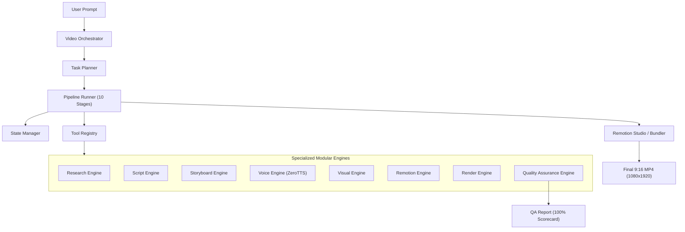

# System Overview — REMOTION-LC AI Video Production

## 1. Architectural Philosophy
REMOTION-LC adopts the **Single Orchestrator Agent + Modular Engines + Tool-Based Execution** paradigm. Rather than running a swarm of fragile, uncoordinated LLM agents, a single Video Orchestrator plans, executes, retries, and coordinates dedicated deterministic TypeScript engines.

## 2. Core Components

### 2.1 Video Orchestrator (`src/orchestrator/VideoOrchestrator.ts`)
- Manages video production lifecycles from raw natural language prompt to rendered MP4.
- Generates tracked project instances and provides subscriber hooks for real-time progress.

### 2.2 Task Planner (`src/orchestrator/TaskPlanner.ts`)
- Determines video category (`tech-news`, `ai-news`, `ai-model-review`, `ai-tool-review`, `github-repo-review`, `ai-explainer`).
- Calibrates duration (30s–60s) and word count at ~2.8 words/sec.
- Matches optimal ZeroTTS voice persona to category.

### 2.3 Pipeline Runner (`src/orchestrator/PipelineRunner.ts`)
- Executes 10 discrete stages with exponential backoff retry (up to 3 attempts).
- Stages: `init` ➔ `research` ➔ `script` ➔ `storyboard` ➔ `voice` ➔ `visuals` ➔ `captions` ➔ `composition` ➔ `render` ➔ `qa` ➔ `complete`.

### 2.4 Modular Engines (`src/engines/`)
- **ResearchEngine:** Extracts entities, specs, and structured facts.
- **ScriptEngine:** Writes 6-part Vietnamese scripts (`hook`, `context`, `main`, `analysis`, `conclusion`, `cta`) and normalizes text for TTS.
- **StoryboardEngine:** Maps script sections to Remotion scene components and allocates exact frame ranges without gaps.
- **VoiceEngine:** Generates real 48kHz WAV speech using the ZeroTTS FastAPI backend service.
- **VisualEngine:** Computes TikTok safe margins (top 160px, bottom 260px) and dark tech editorial styling.
- **RemotionEngine:** Pure composition assembler validating frame tile boundaries.
- **RenderEngine:** Headless Remotion renderer producing vertical MP4s.
- **QualityEngine:** Post-render media inspector via `ffprobe`.
